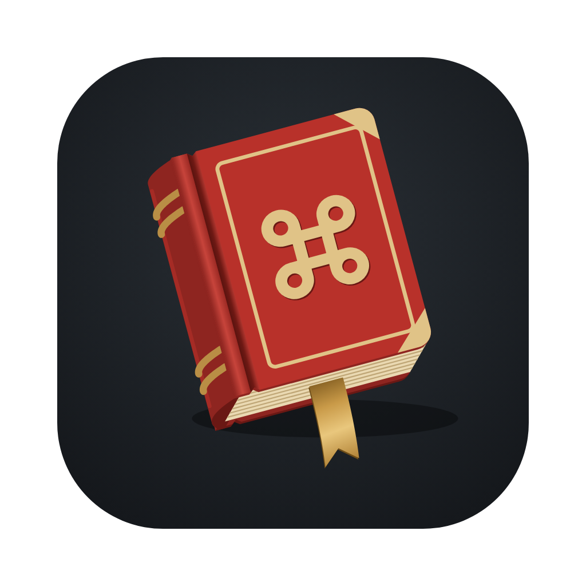
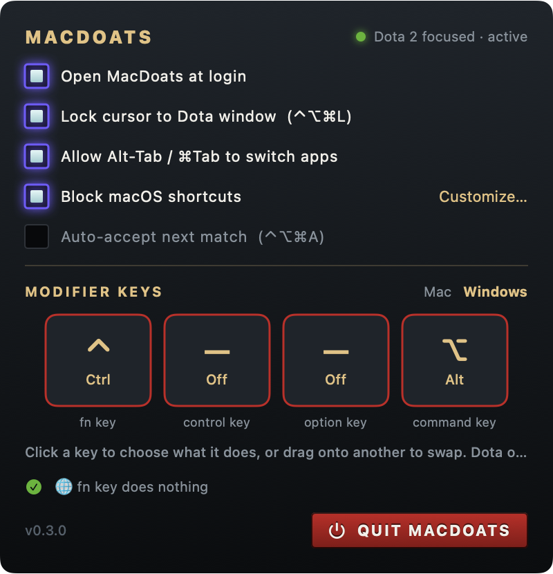
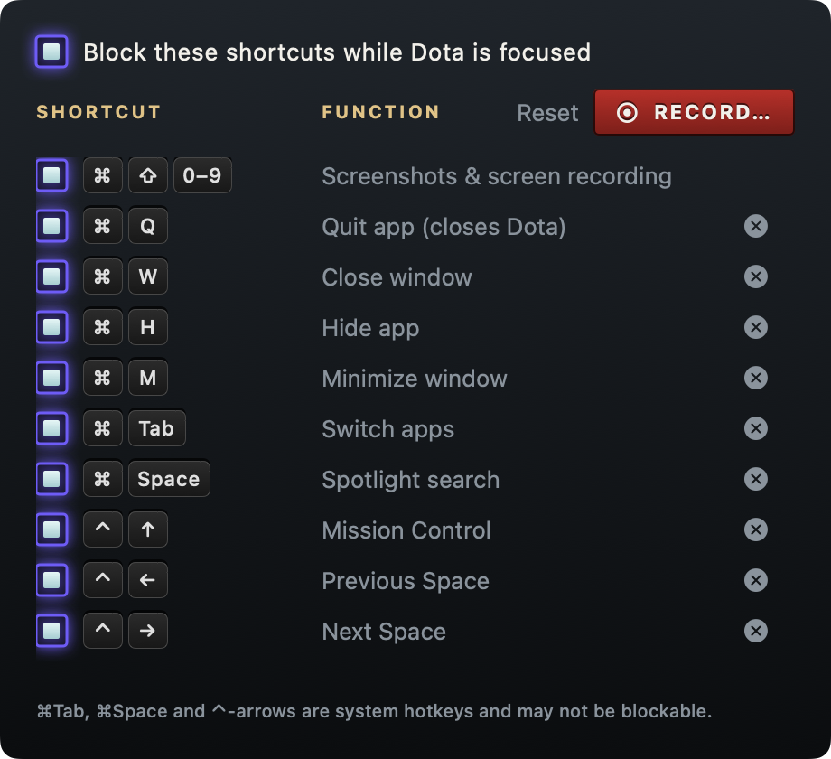
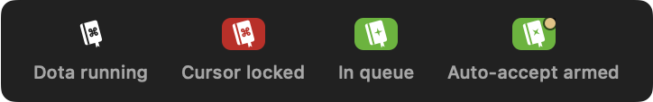

<p align="center">
  
</p>

<h1 align="center">MacDoats</h1>

<p align="center">
  A menu-bar companion that makes Dota 2 behave on a Mac.<br>
  Keeps your cursor in the game, stops ⌘Q from closing the client, lets your modifier keys work the way your fingers expect,
  and accepts your next match while you're away.
</p>

---

<p align="center">
  
  &nbsp;
  
</p>

## Features

- **Cursor lock:** the pointer stays inside the Dota window while it's focused, in borderless, windowed and
  fullscreen modes. Press **⌃⌥⌘L** anywhere to toggle it.
- **Block macOS shortcuts:** ⌘Q, ⌘W, ⌘H, ⌘M, ⌘Space, the Mission Control and Spaces ⌃-arrows, and the screenshot
  keys (⌘⇧ + number) do nothing while Dota is focused. **Customize…** lists each shortcut with its function; turn any
  off, or record your own.
- **Alt-Tab:** with blocking on, you can still switch apps. Hold whichever key you mapped to Alt (⌥) and press Tab.
  This is on by default.
- **Modifier remapping:** four key squares (fn, ⌃, ⌥, ⌘). Drag one onto another to swap them, or click one to choose
  what it does, including Off. Two keys can share the same output.
  - **Mac preset:** fn · ⌃ · ⌥ · ⌘ (unchanged).
  - **Windows preset:** fn → Ctrl, ⌃ → Off, ⌥ → Off, ⌘ → Alt.
- **Auto-accept next match:** press **⌃⌥⌘A** (or tick the box) and walk away. When the accept popup shows, MacDoats
  presses Return for you, once, and only if Dota is in front.
  - It works as a party member too, whoever started the queue.
  - It turns itself off when the match starts, when Dota quits, or after an hour.
  - Sounds: Tink when armed, Pop when off, Glass when the accept landed, Basso when it couldn't press (Dota wasn't in
    front, or the press didn't register).
  - While armed, it keeps your display awake so the Mac doesn't lock mid-queue.
  - **Needs `-condebug`:** in Steam, right-click Dota 2 → Properties → Launch Options, add `-condebug`, and restart
    Dota. Dota then writes a console log, which is how MacDoats knows when a match pops.
  - Dota's *Bring Dota to foreground on match found* option (Options → Advanced) must stay on; it's on by default.
- **Open at login:** one checkbox adds MacDoats to System Settings → General → Login Items.
- **fn / 🌐 key check:** shows whether tapping fn still opens the emoji picker, with a button that opens the macOS
  setting to turn it off.

Everything applies **only while Dota is the focused app**. Switch away and your Mac behaves normally.

## The menu-bar icon



| Icon | Meaning |
|---|---|
| Dimmed tome | Dota isn't running |
| White tome | Dota is running |
| Tome on a red pill | Cursor lock is engaged right now |
| Ticking star on a green pill | You're in the matchmaking queue (queues you started; a party leader's queue isn't visible to members) |
| Gold dot | Auto-accept is armed |

Click the icon for settings. Right-click it for **About MacDoats** and **Quit**.

## Download

Grab `MacDoats-<version>.zip` from [Releases](https://github.com/migsyyy/macdoats/releases). It runs on macOS 14 or
later, on both Apple silicon and Intel.

1. Unzip it and move **MacDoats.app** to Applications.
2. Open it. MacDoats isn't notarised by Apple yet, so macOS blocks the first launch.
3. Go to System Settings → Privacy & Security, scroll down, and click **Open Anyway**.

Or clear the download flag in Terminal instead:

```bash
xattr -dr com.apple.quarantine /Applications/MacDoats.app
```

4. Grant **Accessibility** when asked (see below).

## Build from source

You need macOS 14 or later and the Xcode Command Line Tools (`xcode-select --install`).

```bash
git clone https://github.com/migsyyy/macdoats.git
```

```bash
cd macdoats && ./build.sh && open build/MacDoats.app
```

On first launch, grant **Accessibility** in System Settings → Privacy & Security → Accessibility. MacDoats needs it
to see and filter key and mouse events. Until it's granted, the settings windows are blurred and locked behind a
**Grant Access** card that opens the right pane and goes away once access is on.

> The build is signed ad hoc, so every rebuild invalidates the Accessibility grant. After rebuilding, remove
> MacDoats from the list and add it back.

## Troubleshooting

- **The cursor stays locked even with MacDoats' lock off:** Dota has its own *Lock Mouse to Window* setting.
  MacDoats detects it and shows a warning. Turn it off in Dota's settings, or in the console:
  `dota_mouse_window_lock 0`. Dota saves settings when it quits, so the warning updates after that.
- **Auto-accept is greyed out:** add `-condebug` to Dota's launch options (see Features) and restart Dota.
- **Tapping fn still opens the emoji picker:** set System Settings → Keyboard → "Press 🌐 key to" → **Do Nothing**.
  The row in MacDoats links straight there. macOS may only apply this after you log out and back in.
- **⌘Tab or ⌘Space still work:** macOS handles some system hotkeys before any app sees them, so a few rows in
  Customize… may not be blockable.
- **Screenshots are disabled after a crash:** MacDoats turns the macOS screenshot shortcuts back on when it launches.
  Open it once, or log out and back in.

## How it works

- A `CGEventTap` sees keyboard and mouse events before they reach Dota. While Dota (`com.valvesoftware.dota2`) is
  frontmost, MacDoats:
  - rewrites modifier flags (the remapping);
  - drops blocked shortcuts;
  - clamps the mouse to the Dota window's bounds.
- The screenshot shortcuts are macOS symbolic hotkeys. MacDoats switches them off while Dota is focused and back on
  when you leave Dota, quit MacDoats or launch it again. It uses the same private API that AltTab uses.
- Auto-accept follows Dota's `console.log` (with `-condebug`) through a kernel file watcher, so there's no polling and
  no screen reading. When the log shows the accept popup and Dota is frontmost, MacDoats posts one Return key press.
- MacDoats never modifies Dota's memory or files. It only reads two of them: `console.log`, and
  `machine_convars.vcfg` for Dota's mouse-lock and bring-to-front settings.

## Development

```bash
swift run MacDoats --selftest
```

That runs the self-checks: modifier remapping, plus the log parser and auto-accept decisions replayed on real
Dota log lines. To regenerate the README screenshots from the real views (factory settings, Dota shown as
focused), run `build/MacDoats.app/Contents/MacOS/MacDoats --screenshots docs/screenshots`. To try MacDoats without Dota, point it at another app:

```bash
defaults write dev.macdoats.app targetBundleIDs -array com.apple.TextEdit
```

```bash
defaults delete dev.macdoats.app targetBundleIDs
```

| Path | What's there |
|---|---|
| `Sources/Engine.swift` | Event tap, remapping, cursor lock, shortcut and screenshot blocking |
| `Sources/UI.swift` | Settings panel, key squares, Customize… window, Dota-style checkboxes |
| `Sources/StatusItem.swift` | Menu-bar item, popover, right-click menu |
| `Sources/Icon.swift` | Menu-bar glyph, drawn in code from the logo geometry, and the queue star |
| `Sources/DotaLog.swift` | `console.log` watcher, line parser, auto-accept decisions |
| `Sources/SelfTest.swift` | `--selftest` checks |
| `design/logo/kit/` | Logo source scripts, exports, presentation board, usage guide |

**Versioning:** [SemVer](https://semver.org). The version lives in `Info.plist` (`CFBundleShortVersionString`), and
releases are tagged `vX.Y.Z`. `build.sh` sets the build number to the git commit count.

## Disclaimer

MacDoats is a fan-made utility, not affiliated with or endorsed by Valve. Dota 2 and DotA are trademarks of Valve
Corporation. It changes only how macOS handles your input, but use it at your own risk.
